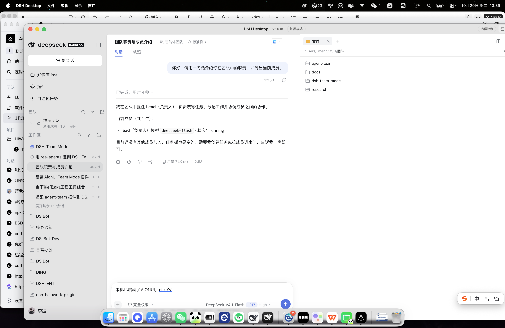
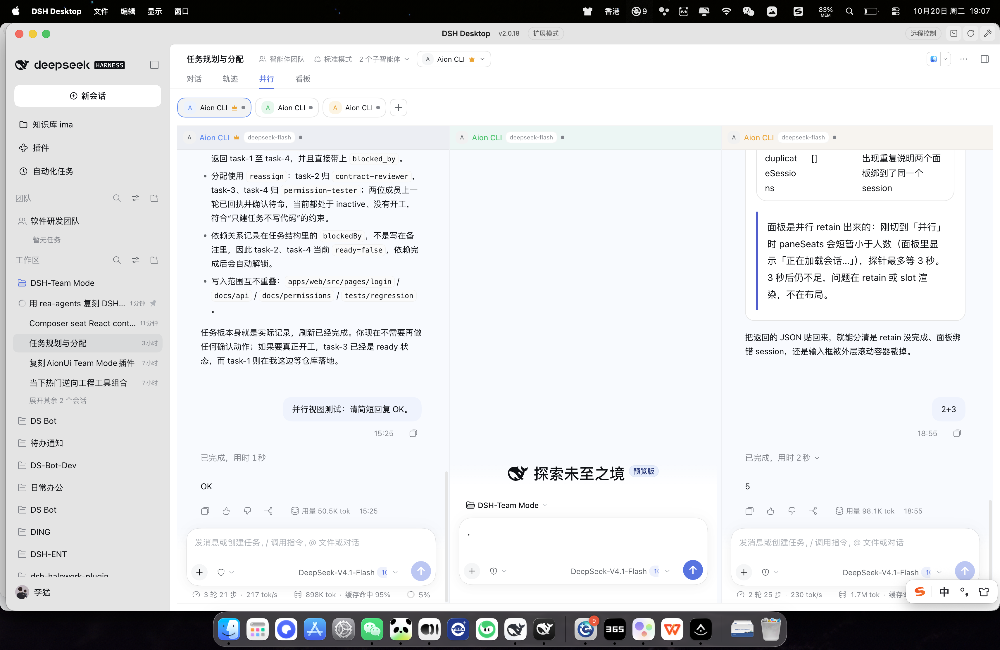
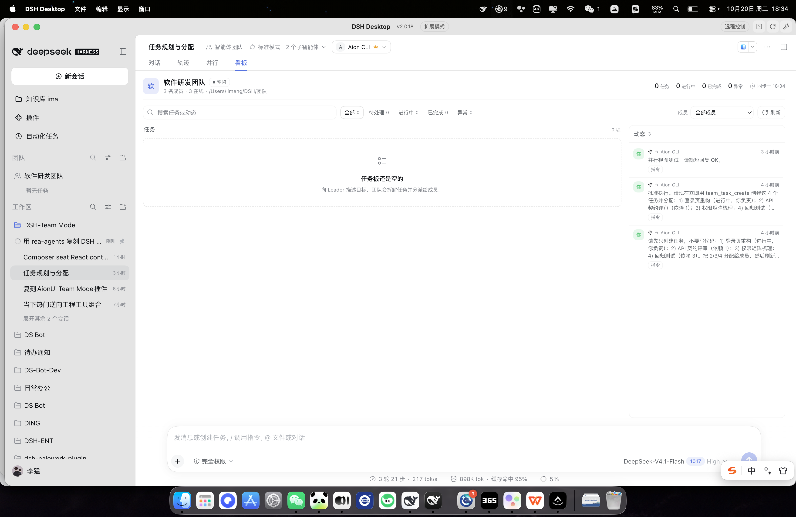
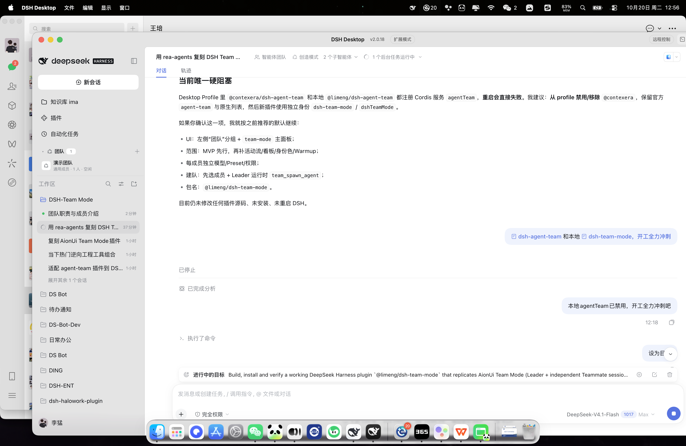

# DSH-Team Mode

AionUi-style multi-agent **Team Mode** for DeepSeek Harness: one Leader coordinates independent Teammates, each with its own model, permissions, Session, and context, while all members share one Workspace.



## What it is

- **一份 DSH 插件，不是 CLI 包装**：不依赖 Claude Code / Codex / Gemini CLI / ACP，直接使用 DSH 的 Agent、Session、模型、Preset、Skills/MCP、权限、Workspace。
- **左侧会话列表里的“团队”分组**：与原生“工作区”同一行样式（14px、同一左/右对齐、搜索 / 视图选项 / 新建图标）；列出团队、Leader、成员数、运行状态与待确认角标。
- **Leader + 独立 Teammates**：每个成员都是独立根 Agent，拥有独立模型/Preset/思考档/权限/上下文；不是 subagent。
- **主体完全复用 DSH 会话**：点击团队或成员直接在原生 Session 视图中打开；消息流、输入框、附件、文件 @、右侧文件/变更 sidebar 全部是 DSH 原组件，不再有独立 Team Mode 页面。
- **24 个原生 team_* 工具**（21 个主名 + 3 个兼容别名）：`team_members`、`team_read_messages`、`team_send_message`、`team_interrupt_agent`、`team_mode_goal_create`、`team_mode_goal_list`、`team_mode_goal_update`、`team_mode_task_create`、`team_mode_task_update`、`team_mode_task_claim`、`team_mode_task_list`、`team_mode_inbox`、`team_memory_propose`、`team_memory_list`、`team_memory_accept`、`team_list_assistants`、`team_describe_assistant`、`team_spawn_agent`、`team_rename_agent`、`team_clear_agent_context`、`team_shutdown_agent`；兼容别名 `team_create_task`、`team_update_task`、`team_get_task_board`。
- **持久邮箱 + 任务板**：任务 owner 自动唤醒、依赖/阻塞、完成自动解除下游、广播、未读/已读、4000 字符预览。
- **动态成员生命周期**：创建后添加/移出/重命名/换 Leader/清空单个成员上下文/优雅下线；Leader 只能由用户明确要求下线成员。
- **每成员权限**：只读 / 工作区可写 / 完全访问；成员列内审批/提问卡片，侧边栏与胶囊显示待确认数量。


## Parallel and board views

A team member Session is still a normal DSH conversation. Team sessions get two extra view tabs:

- **并行**: every team member is an independent embedded conversation column. Each column renders the official `conversation.content` and therefore its own official `InputBar`/input hub. The wall only fills the visible chat viewport; each column's message flow scrolls independently, and each column has its own identity color.
- **看板**: team tasks grouped by status, with an activity feed, filters, and task-to-owner navigation.

Member controls:

- `+` in the parallel member bar reuses the existing add-member picker.
- Team management member cards support inline rename (double-click or pencil), backed by `team.renameMember`.
- In single-chat view, the conversation header has a member switcher; choosing a member opens that member Session without forcing the right sidebar.
- Empty member/Leader Sessions show an additive AionUi-style hint through `conversation.hero.options`; no fake user/assistant message is written.





## Quick start

1. 让 `@contexera/dsh-agent-team` 与旧 `@limeng/dsh-agent-team` 保持禁用（二者与官方 `agent-team` / 本插件使用不同服务名）。
2. 安装到当前 Profile：

```bash
npm pack --pack-destination /tmp
dsh plugin --profile web add /tmp/limeng-dsh-team-mode-0.4.0.tgz
```

也可以直接从本地目录安装：

```bash
dsh plugin --profile web add /absolute/path/to/dsh-team-mode
```

桌面版也可以用插件管理器安装本地 bundle 目录。安装后重启/刷新 DSH Web UI。尚未发布到 npm Registry，详见 [安装文档](./docs/installation.md)。

3. 左侧会话列表出现 **团队** 分组，点击 `+`。
4. 如果还没有成员模板，在“新建团队”弹窗点击 **创建默认成员**（使用当前默认 Provider/模型）。
5. 选择 Leader 和成员 → 团队名 → Workspace → **创建并启动**。
6. 在 Leader 会话描述目标。Leader 会先给出阵容/计划，确认后再 `team_spawn_agent`、建任务、派活。

## Screenshots




## Architecture

```text
DSH Web Client
  sidebar.workspaces DOM anchor
    └─ “团队” section (portal; native Workspace/Session browser untouched)
  shell.overlay
    └─ parallel wall host (portals official embedded member conversations)
  conversation.view
    └─ team-parallel / team-board tabs (team member Sessions only)
  conversation.session.header.actions
    └─ single-chat member switcher
  settings.section
    └─ member templates / model / permission

Host plugin (@limeng/dsh-team-mode)
  TeamMode service  — teams, members, tasks, mailbox, activities, quotas
  TeamRuntime       — independent root Agent sessions, presets, models, prompts
  InteractionBridge — questions/approvals per member
  WorkspaceService  — tree/search/diff/upload
  Web transport     — /dsh-team-mode/api, /events, /upload
```

Members are created with `ctx.agents.create`/`resume` + `ctx.agentPresets.mount`; tools are registered in each member's scoped Agent context. No MCP server/bridge is involved.

## Development

```bash
npm install
npm run typecheck
npm test
npm run build
npm run check
```

Build output: `lib/index.js` (host), `lib/client.js` (browser bundle).

## Compatibility

- DeepSeek Harness `0.2.1-rc.2`
- Node `^22.19.0 || >=24.0.0`
- React 18 client

## Known limits

- Team Mode has no separate main page: the sidebar group is the entry, and every team/member opens a shipped DSH Session. Team create/manage are Modal surfaces.
- The parallel wall is an additive view inside the member Session, not a second app. The board is a sibling view tab; the team management Modal remains the place for configuration.
- A team workspace’s member sessions also remain visible in the native Workspace list (the team group is the shortcut); collapse that Workspace if you want the team group to be the only entry.
- `team_read_messages` marks read when the tool executes; direct messages use `deliveryState`, broadcasts use `readBy`.
- Pending shutdown handshakes are in-memory and not restored after a restart.
- Custom sidebar layout keeps the native row in place and only hides it; mirrors forward clicks. Mirrored buttons follow selection, active state, badges and `disabled`, but not hover/transition details or third-party custom state. Assignments are keyed by the accessible label, so switching the interface language drops the old assignment and the entry falls back to its original position.

## License

MIT. The host runtime is derived from `limuyang2/agent-team` (MIT); AionUi Team Mode behavior was used as the product reference (Apache-2.0).
